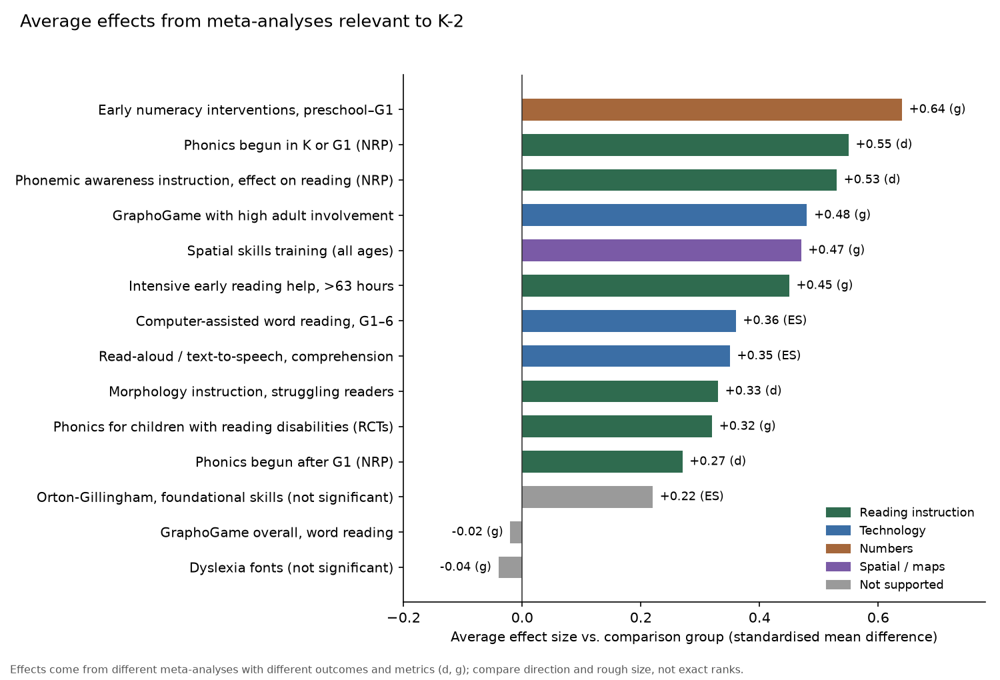

# Research foundations for Bede's K-2 plan, with a focus on dyslexia

This review checks Bede's 36-week K-2 plan ([`K2_SCHOOL_YEAR_PLAN.md`](K2_SCHOOL_YEAR_PLAN.md)) (numbers, English phonics, native Mexican Spanish phonics, sight words and maps) against the academic evidence, especially the evidence on dyslexia. It favours meta-analyses, randomised trials, U.S. Institute of Education Sciences (IES) practice guides and the International Dyslexia Association (IDA) definition. Single studies are used only where no synthesis exists.

## Summary

- **The plan is built on the strongest finding in the field.** Explicit, systematic phonics is the one dyslexia treatment whose effect has been statistically confirmed in randomised trials. It works best when it starts in kindergarten or first grade.
- **Dyslexia looks different in Spanish.** In English it shows up as both errors and slowness. In Spanish, which is spelled consistently, it shows up mainly as slow, effortful reading. Spanish practice therefore has to build reading speed and track it, not just accuracy.
- **Sight words should be learned through their sounds, not memorised as shapes.** Most high-frequency words are regular. Irregular words are learned better when the child spells them or corrects the pronunciation than when they just look and say.
- **An app alone is not enough.** Computer-assisted word reading has a moderate average effect. But the best-known phonics game, GraphoGame, had about zero effect overall and a meaningful effect only where adults were closely involved. Bede's parent-in-the-loop design is the part to protect.
- **Reading and maths difficulties often come together.** Number work must not depend on the child's reading. Number lines and linear board games are among the best-supported early number tools.
- **Several popular dyslexia features have no support:** dyslexia fonts, coloured overlays, Orton-Gillingham as a brand, and spelling by memorisation alone. Bede already leaves out dyslexia fonts and offers letter spacing, which does have experimental support.

## What dyslexia is, by the current definition

In October 2025 the IDA board approved a new definition. Dyslexia is "a specific learning disability characterized by difficulties in word reading and/or spelling that involve accuracy, speed, or both and vary depending on the orthography." The difficulties "persist even with instruction that is effective for the individual's peers" ([IDA definition](https://dyslexiaida.org/definition-of-dyslexia/)). The definition adds that early oral language weaknesses often foreshadow literacy problems. It also says that support "before and during the early years of education is particularly effective" ([IDA definition](https://dyslexiaida.org/definition-of-dyslexia/)).

The paper explaining the revision records three changes that matter for Bede ([Annals of Dyslexia, 2025 revision](https://link.springer.com/article/10.1007/s11881-026-00363-4)):

- **The IQ-discrepancy wording is gone.** Dyslexia is no longer defined by a gap between reading and "other cognitive abilities".
- **Orthography is part of the definition.** Children with dyslexia in transparent orthographies such as Spanish, Italian and Finnish may make few word-reading errors and instead be "rate-disabled". Their problems are speed and automaticity.
- **Risk is not diagnosis.** Weak phonological awareness, slow rapid naming and weak oral language raise risk, but no single sign confirms or rules out dyslexia.

For Bede, this supports a firm product rule: watch for risk signs and tell the parent, but never label the child.

## English phonics and phonological awareness

### The core evidence

The National Reading Panel's meta-analysis pooled 66 comparisons from 38 experiments. Systematic phonics beat every comparison condition, including whole language, with an average effect of d = 0.41 ([Ehri et al., 2001](https://journals.sagepub.com/doi/10.3102/00346543071003393)). The effect was larger when instruction began early (d = 0.55) than after first grade (d = 0.27). It helped younger children at risk of reading disability and older children with one. Small-group and whole-class teaching were "not less effective than tutoring" ([Ehri et al., 2001](https://journals.sagepub.com/doi/10.3102/00346543071003393)).

A meta-analysis limited to randomised trials with children who have reading disabilities is the most dyslexia-specific evidence. It covered 22 RCTs and 49 comparisons. Phonics was the only approach with a statistically confirmed effect on reading: g = 0.32, or 0.42 with standardised measures only ([Galuschka et al., 2014](https://dx.plos.org/10.1371/journal.pone.0089900)). The comparison approaches included fluency training, auditory training, coloured overlays or lenses, and medical treatments ([Galuschka et al., 2014](https://dx.plos.org/10.1371/journal.pone.0089900)).

Phonemic awareness (PA) training had a large effect on PA itself (d = 0.86) and moderate effects on reading (d = 0.53) and spelling (d = 0.59). It worked better under four conditions ([Ehri et al., 2001, PA](https://ila.onlinelibrary.wiley.com/doi/10.1598/RRQ.36.3.2)):

- when taught with letters;
- when it focused on one or two PA skills rather than many;
- in small groups;
- when it totalled 5–18 hours rather than more.

The IES K-3 practice guide rates two of its recommendations as strong evidence ([IES Foundational Skills guide](https://ies.ed.gov/ncee/wwc/Docs/PracticeGuide/wwc_found_reading_summary_051517.pdf)):

- linking sound segments to letters;
- teaching decoding, word parts and word recognition.

Daily reading of connected text is rated moderate. The guide's order runs from sentences to words, then syllables, then onset and rime, then single phonemes. Letter teaching starts with consonants and short vowels, then blends and digraphs, silent e, and vowel teams ([IES Foundational Skills guide](https://ies.ed.gov/ncee/wwc/Docs/PracticeGuide/wwc_found_reading_summary_051517.pdf)). Bede's English sequence follows this order.

### Intensity, and what 1:1 really means

A meta-analysis of intensive early reading interventions (K-3, 25 studies) found that one-to-one help produced larger effects (0.59) than small groups (0.33). Programmes over 63 hours outperformed shorter ones (0.45 vs. 0.33) ([Wanzek et al., 2018](https://journals.sagepub.com/doi/10.1177/0022219418775110)). Those were human tutors. Bede's sessions are one-to-one, but the evidence on software (below) shows an app does not automatically match a tutor.

### What the plan does with this

- Letter sounds begin in kindergarten week 5, after four weeks of sound-only work. This fits the finding that PA works best with letters.
- English PA work is concentrated in kindergarten and early grade 1, matching the IES timeline, in which PA fades out during the second half of grade 1.
- One skill per week is a default pace, not a requirement. Children at risk need more hours. The next phonics skill should open only once the current one is mastered, while numbers and maps keep moving. Bede's existing mastery rules already work this way.

## Sight words: what the research says to do

### Orthographic mapping, not shape memory

Ehri's account of orthographic mapping explains how a word becomes a "sight word": letter-sound connections bind the spelling, pronunciation and meaning of a specific word in memory ([Ehri, 2014](http://www.tandfonline.com/doi/abs/10.1080/10888438.2013.819356)). Sight words are learned through phonics, not around it. A 2024 analysis of the Dolch list found "overwhelming regularity" in its letter-sound patterns. The authors argue that memorising high-frequency words without attention to those patterns ignores how words are stored ([Reading Psychology, 2024](https://www.tandfonline.com/doi/full/10.1080/02702711.2024.2379255)).

### Irregular words: spell them or correct them

The evidence on irregular words comes from three studies:

- **Kindergarten trial.** In a trial with 85 kindergartners, Look-and-Spell and mispronunciation correction both beat Look-and-Say. Mispronunciation correction means reading the word as spelled ("s-ai-d") and then fixing it to the real word ([Scientific Studies of Reading, 2022](https://www.tandfonline.com/doi/full/10.1080/10888438.2022.2077653)). The authors conclude that "active processing of a word's orthography is crucial".
- **Heart words versus mispronunciation correction.** A 2026 study with 60 Year 1 children found both methods beat look-and-say for reading and spelling, with no difference between them ([Scientific Studies of Reading, 2026](https://www.tandfonline.com/doi/full/10.1080/10888438.2026.2671171)). Heart words mark the part of the word that breaks the rule.
- **Cluster RCT with struggling readers.** A trial with 273 struggling readers in grades 2–3 added mispronunciation-correction training to phonics. It produced large gains comparable to adding morphology, including on irregular words ([Journal of Learning Disabilities, 2024](https://journals.sagepub.com/doi/10.1177/00222194241297058)).

For spelling, a meta-analysis of 34 controlled trials with learners with dyslexia found moderate to high effects for phonics, spelling-rule and morphology instruction. A benefit from memorisation strategies "could not be confirmed" ([Galuschka et al., 2020](https://www.tandfonline.com/doi/full/10.1080/00461520.2019.1659794)). The IES guide says the same thing in practical terms. Regular high-frequency words are decoded first and then practised until fast. Irregular ones are taught within the phonics sequence, flagged as "rule-breakers", and spelled aloud to draw attention to the middle sounds ([IES Foundational Skills guide](https://ies.ed.gov/ncee/wwc/Docs/PracticeGuide/wwc_found_reading_summary_051517.pdf)).

### What the plan does with this

The sight-word strand targets about 25 words by the end of kindergarten, 100 by the end of grade 1 and 300 by the end of grade 2. It should follow four rules:

1. A regular word enters the strand only after its pattern has been taught in phonics.
2. Each irregular word is marked as a heart word. The child says its sounds, finds the tricky part and spells it, and Bede uses mispronunciation correction when a child reads it as spelled.
3. Do not use flash-card "look and say" practice as the main method.
4. Review on a spaced schedule (see "Review and spacing").

## Spanish: a native, syllable-based year

### Why Spanish needs its own design

Cross-language studies agree on three points:

- **Phonological awareness predicts less in transparent orthographies.** In a five-language study of 1,265 second graders, PA was the strongest correlate of reading in most languages. Its influence grew as spelling became less transparent ([Ziegler et al., 2010](https://sapientia.ualg.pt/server/api/core/bitstreams/377e33c9-52f0-4ad1-b888-d4ee44dd4cfc/content)).
- **Rapid naming predicts reading speed in every orthography.** A longitudinal study of 1,120 children in five orthographies found RAN was a consistent predictor of later reading fluency ([Landerl et al., 2019](https://acuresearchbank.acu.edu.au/download/baf77f811457fc9d00dcc2a94dbb59b4e0f67b73f22efded099dec4231b98083/1379004/OA_Landerl_2019_Phonological_awareness_and_rapid_automatized_naming.pdf)). The PA-reading relationship there was two-way and language-specific. A meta-analysis of 137 studies put the RAN-reading correlation at r = .43 overall, and r = .48 for fluency in transparent orthographies ([Araújo et al., 2015](https://pure.mpg.de/rest/items/item_2067377_4/component/file_2182190/content)). RAN means rapid automatized naming: naming familiar items quickly.
- **Spanish dyslexia is mostly a speed problem.** Spanish children with dyslexia showed deficits on every task, "more clearly when performance time was considered" ([Serrano and Defior, 2008](https://pubmed.ncbi.nlm.nih.gov/18483868/)). Spanish dyslexic readers were slowed mainly by word length, which points to letter-by-letter or syllable-by-syllable decoding. Typical readers were influenced by age of acquisition, a whole-word variable ([Annals of Dyslexia, 2011](https://link.springer.com/article/10.1007/s11881-011-0064-y)). A Spanish fluency programme for dyslexia is built on the same reasoning. It combines syllable, word and text reading, repeated reading and faster reading, because "reading-speed measures are more informative than accuracy" in Spanish ([Escritos de Psicología, 2011](https://scielo.isciii.es/scielo.php?script=sci_arttext&pid=S1989-38092011000200008&lng=pt&nrm=iss&tlng=es)).

### Evidence for a syllable-based order

The método silábico used in Mexico has research support on several points:

- **A Spanish intervention trial taught syllables directly.** In a Texas trial with first graders at risk, children whose core reading was in Spanish had 50 minutes a day in groups of 3–5 for about seven months ([Vaughn et al., 2006](https://readingrecovery.org/wp-content/uploads/2023/03/Effectiveness20of20Spanish20Intervention20for20ELLs.pdf)). The lessons included:
  - phoneme segmenting and blending;
  - reading syllables first by sounding out and then as units;
  - speeded syllable reading;
  - decoding long words syllable by syllable.

  Effects included d = 0.73 on phonological awareness, 0.85 on word attack, 0.55 on passage comprehension and 0.58–0.75 on fluency ([Journal of Learning Disabilities, 2006](https://journals.sagepub.com/doi/10.1177/00222194060390010601)).
- **Simple syllables are easier to store.** New words with simple syllable structures, and without context-dependent letters such as c/qu or g/gu, were easier to form memory representations for ([Journal of Child Language](https://www.cambridge.org/core/journals/journal-of-child-language/article/abs/role-of-sublexical-variables-in-reading-fluency-development-among-spanish-children/EACAB5EE233B1C9B268A66192491FC9F)). This supports the plan's order: vowels, then consonant-vowel syllables, then context-dependent spellings, then blends.
- **Common syllables help.** Spanish-speaking second and fifth graders recognised words with high-frequency first syllables faster ([Literatura y Lingüística, 2019](https://www.scielo.cl/scielo.php?pid=S0718-48832019000200165&script=sci_arttext)). Early words should use common syllables.
- **Blends, diphthongs, accents and length are hard.** In California, 1,000+ bilingual first and second graders found longer items hardest, and blends, diphthongs and written accents also raised difficulty ([Reading and Writing, 2026](https://link.springer.com/10.1007/s11145-026-10818-0)). This supports placing trabadas late in grade 1 and diphthongs and tildes in grade 2.

### Bilingual children

For 251 Spanish-speaking English learners from K to grade 2, transfer from Spanish to English was modest. English PA and RAN carried most of the Spanish contribution to later reading ([Manis et al., 2004](https://eric.ed.gov/?id=EJ687015)). Spanish phonics is not a substitute for English phonics. A bilingual child needs both strands. The IES English-learner guide rates small-group help for struggling learners as moderate evidence ([IES English Learners guide](http://www.ies.ed.gov/ncee/WWC/Docs/PracticeGuide/50629_TeachingAcademicContentLiteracy_PG_Summary_final.pdf)).

### What the plan does with this

- **Kindergarten (Spanish) now starts letters sooner.** The first draft had six weeks of sound-only work before any vowel. The revised order teaches rimas and syllable clapping in weeks 1–2 and vowels in weeks 3–7. Syllable blending, syllable segmenting and words in a sentence are spread among the first consonant weeks, so PA is practised with letters.
- **Phoneme segmenting has been added.** Kindergarten week 31 is now "Separar una sílaba en sonidos (m-a, ma)", following the Vaughn et al. content.
- **Fluency is a daily strand from late kindergarten.** It is a one-minute reread of syllables and words already taught. A kindergarten week 34 "Leer sílabas conocidas con soltura" introduces it.
- **Spanish frequent words stay inside phonics.** Spanish spelling is transparent, so the plan does not add a separate Spanish memorisation list.

## Review and spacing

A meta-analysis of 29 studies found spaced retrieval practice beat massed practice for retention: g = 1.01, or 0.74 after correcting for publication bias ([Latimier et al.](http://www.lscp.net/persons/ramus/docs/EPR20.pdf)). Expanding schedules were no better than evenly spaced ones (g = 0.03). Most of those studies involved adults, but one preschool study was included ([Latimier et al.](http://www.lscp.net/persons/ramus/docs/EPR20.pdf)). The IES maths guide also recommends mixing earlier and new material within and across lessons ([IES maths intervention guide](https://ies.ed.gov/ncee/wwc/Docs/PracticeGuide/WWC-PraxGuide-Elementary-Math-Summary-508c.pdf)).

For the plan, a simple rule is enough. Each day's round includes a few items from earlier weeks, and the four review weeks at the end of each year stay. A complex adaptive spacing algorithm is not justified by the evidence, which fits the instruction to keep the implementation simple.

## Morphology and connected text

Morphology instruction improved literacy across 17 studies (d = 0.33), with gains in phonological awareness, vocabulary, comprehension and spelling. It helped struggling readers, English learners and children with disabilities in particular ([Goodwin and Ahn, 2010](https://eric.ed.gov/?id=EJ905044)). This supports the grade 2 English prefix and suffix weeks and the grade 2 Spanish weeks on prefijos, sufijos, familias de palabras and plurales.

On texts, interventions using only decodable texts and those using only ordinary texts had about the same effect. The few studies that combined both suggested the mix works best, especially for word recognition ([TextProject summary of Pugh et al., 2023](https://textproject.org/research/reading-research-snapshots/text-types)). Bede can pair short decodable cuentos and stories with the living books read aloud by the parent.

## What technology can and cannot do

Three syntheses frame Bede's role:

- **Computer-assisted word reading.** In grades 1–6 (67 studies, 10,734 children), the average effect was 0.36. Effects were similar for accuracy, speed and spelling. Supplementary alphabetics programmes did best (0.42) and fluency-only programmes worst (0.26) ([Verhoeven et al., 2022](https://repository.ubn.ru.nl/bitstream/handle/2066/284886/284886.pdf?sequence=1)).
- **Core digital reading instruction.** Across 72 studies the effect was g = 0.37. Game elements and adaptivity "made little difference" ([British Journal of Educational Technology](https://onlinelibrary.wiley.com/doi/10.1111/bjet.13351)).
- **GraphoGame.** A review of 28 studies found an overall word-reading effect of g = −0.02. Studies with high adult interaction averaged g = 0.48 ([McTigue et al., 2020](https://eric.ed.gov/?id=EJ1238280)). A Dutch cluster RCT found gains in letter-sound knowledge from short daily play ([Frontiers / PMC, 2023](https://pmc.ncbi.nlm.nih.gov/articles/PMC10399564/)). In Spanish, poor readers in grade 2 had made slower progress in the game in kindergarten and grade 1, which suggests progress data can be an early warning ([Child Language Teaching and Therapy, 2022](http://journals.sagepub.com/doi/10.1177/02656590221139232)).

Speech-recognition reading tutors are the closest thing to Bede's narration mode. Project LISTEN's Reading Tutor beat matched sustained-silent-reading peers on several skills, with effect sizes of 0.20–0.72. In one study it did as well as human tutoring on word comprehension ([Project LISTEN publications](https://www.cs.cmu.edu/~listen/pubs.html)). However, the What Works Clearinghouse found no study that met its standards, so the evidence is promising but not proven ([WWC](https://ies.ed.gov/ncee/wwc/EvidenceSnapshot/391)).

Two lessons follow. Neither game features nor adaptivity is the active ingredient; explicit phonics content is. And the parent being involved is what separates GraphoGame's zero effect from its 0.48 effect. Bede's "Watch, Together, Your turn" structure and parent reports should keep the "Together" step parent-led wherever possible.

## Spotting risk early, without diagnosing

The IDA's 2025 paper lists the risk indicators: phonological and morphological difficulties, slow rapid naming and early oral-language weakness ([Annals of Dyslexia, 2025 revision](https://link.springer.com/article/10.1007/s11881-026-00363-4)). A Spanish game-based screener, Dytective, has been tested in a sample of 243 people, 95 of them with a diagnosis. Its model predicted dyslexia with 85.85% accuracy in that sample, which included adults ([Rello et al., 2015](https://www.cs.cmu.edu/~jbigham/pubs/pdfs/2015/dytective.pdf)). By April 2026 it was used in over 5,000 Spanish schools, and its own operators describe it as a detection tool, "not a clinical diagnosis" ([Europa Press, 2026](https://www.europapress.es/epsocial/infancia/noticia-dytective-plataforma-espanola-contra-dislexia-llega-5000-colegios-estamos-mas-cerca-superar-barreras-20260418110249.html)).

Bede does not need a screener to be useful. It already records how much help each item took. A parent-facing note could say something like "letter sounds are taking longer than usual; a reading specialist can check" when three conditions hold:

- letter-sound weeks need repeating despite daily practice;
- Spanish syllable reading stays slow while accuracy is fine;
- naming known letters or pictures is consistently slow.

Bede would never label the child or show the note to them.

## Numbers: reading and maths difficulties overlap

In a population sample of 691 Spanish fifth and sixth graders, 48.3% of children at risk for dyscalculia also had reading difficulties. Of those at risk for dyslexia, 23.7% had maths difficulties. The overlap was well above chance (2.0% observed vs. 0.36% expected) ([Frontiers in Psychology, 2025](https://www.frontiersin.org/articles/10.3389/fpsyg.2025.1664437/full)). For the numbers strand, two things follow. Story problems should always be read aloud, and number skills should never be blocked by a reading skill.

Early numeracy interventions from preschool to grade 1 had an average effect of g = 0.64 across 34 studies. They were larger when they included counting with one-to-one correspondence and when they lasted 8 weeks or less ([Nelson and McMaster, 2019](https://psycnet.apa.org/record/2018-63406-001)). Low-income preschoolers who played a linear number board game for about an hour improved more in number-line estimation and magnitude comparison than children who played a circular game. They also learned arithmetic better later ([Siegler and Ramani, 2009](https://eric.ed.gov/?id=EJ861180)). The IES maths intervention guide rates six practices as strong evidence ([IES maths intervention guide](https://ies.ed.gov/ncee/wwc/Docs/PracticeGuide/WWC-PraxGuide-Elementary-Math-Summary-508c.pdf)):

- systematic instruction;
- precise mathematical language;
- concrete and drawn representations;
- the number line;
- word-problem instruction;
- regular timed fluency activities.

Bede's IM-based order already has one-to-one matching, ten-frames and number bonds. Two additions are suggested:

- a linear number-path game as a practice format in kindergarten counting weeks;
- the number line as a standing representation from kindergarten, not only in grade 2.

## Maps: a step-by-step progression

Maps are not transparent to young children. Learning them is gradual, and it covers three things: knowing what a map is, recognising its parts, and using it ([Liben and Downs, 1989](https://pubmed.ncbi.nlm.nih.gov/2480701/)). A 2024 review recommends five steps, each mastered before the next ([European Early Childhood Education Research Journal, 2024](https://www.tandfonline.com/doi/full/10.1080/1350293X.2024.2322528)):

1. real-world activity;
2. eye-level photos;
3. oblique (tilted) pictures and picture maps;
4. vertical maps;
5. abstract maps.

Spatial skills respond to training. Across 217 studies the average effect was g = 0.47, and it lasted and transferred to untrained spatial tasks ([Uttal et al., 2013](https://eric.ed.gov/?id=EJ1006934)). For children aged 0–8 specifically, the average across 20 studies was g = 0.96 ([Frontiers in Psychology, 2020](https://pmc.ncbi.nlm.nih.gov/articles/PMC7485443/)).

In response, kindergarten map week 6 changes from "A map is a picture from above" to "Photo, tilted view, then from above: one room three ways". This puts the eye-level and oblique steps before the bird's-eye view.

## Screen presentation

Bede's accessibility work is already in line with the evidence. In dyslexic children aged 8–14 reading Italian or French, extra letter spacing roughly halved errors and raised speed ([Zorzi et al., 2012](https://pmc.ncbi.nlm.nih.gov/articles/PMC3396504/)). A 2026 meta-analysis of 15 studies and 688 dyslexic readers found dyslexia-friendly fonts had no effect (g = −0.04) ([Annals of Dyslexia, 2026](https://link.springer.com/article/10.1007/s11881-026-00389-8)). Bede's letter-spacing setting and its decision not to offer a dyslexia font both stand.

Text-to-speech and read-aloud tools improved reading comprehension for students with reading difficulties (average effect 0.35) ([Wood et al., 2017](https://journals.sagepub.com/doi/10.1177/0022219416688170)). This supports reading aloud content such as story problems, map questions and books. It does not support reading aloud the word a child is meant to decode, which would remove the practice.

## Approaches the evidence does not support

| Approach | Finding | Implication for Bede |
|---|---|---|
| Orton-Gillingham as a programme | Foundational skills effect 0.22, p = .40, not significant ([Stevens et al., 2021](https://journals.sagepub.com/doi/10.1177/0014402921993406)) | Describe Bede as explicit, systematic phonics, not "Orton-Gillingham" |
| Dyslexia fonts | g = −0.04 across 15 studies ([Annals of Dyslexia, 2026](https://link.springer.com/article/10.1007/s11881-026-00389-8)) | Keep not offering one |
| Coloured overlays or lenses | Tested in 4 RCT comparisons; only phonics had a confirmed effect ([Galuschka et al., 2014](https://dx.plos.org/10.1371/journal.pone.0089900)) | Do not add |
| Memorising spellings by sight | No confirmed effect ([Galuschka et al., 2020](https://www.tandfonline.com/doi/full/10.1080/00461520.2019.1659794)) | Teach heart words through sounds and spelling |
| Game features as the active ingredient | Little difference to effects ([BJET](https://onlinelibrary.wiley.com/doi/10.1111/bjet.13351)) | Spend effort on content and parent involvement, not rewards |

## One decision the evidence raises

Bede's guidance says it will "never hurry your child, time them, or mention pace to them". The evidence on Spanish dyslexia makes speed the main sign to track. The IES maths guide also rates timed fluency activities as strong evidence ([IES maths intervention guide](https://ies.ed.gov/ncee/wwc/Docs/PracticeGuide/WWC-PraxGuide-Elementary-Math-Summary-508c.pdf)). One option that keeps the child-facing promise is to record reading rate silently from read-aloud turns and show it only to the parent, with no timer on the child's screen. A further option is an optional "beat your own time" game the parent can turn on.

## Gaps and limits

- Few randomised trials test full K-2 phonics sequences for Spanish dyslexia specifically. Most Spanish evidence is correlational or comes from bilingual U.S. samples.
- No study was found that sets a research-based number of sight words per grade. The 25/100/300 targets are practice benchmarks, not research results.
- No study was found linking map-skill instruction to dyslexia. The map evidence is general child spatial development.
- Several effect sizes come from abstracts because the full texts were paywalled, including the National Reading Panel analyses, Stevens et al. and Nelson and McMaster.
- Average effects from different meta-analyses use different outcomes and metrics. They show direction and rough size, not a ranking.
